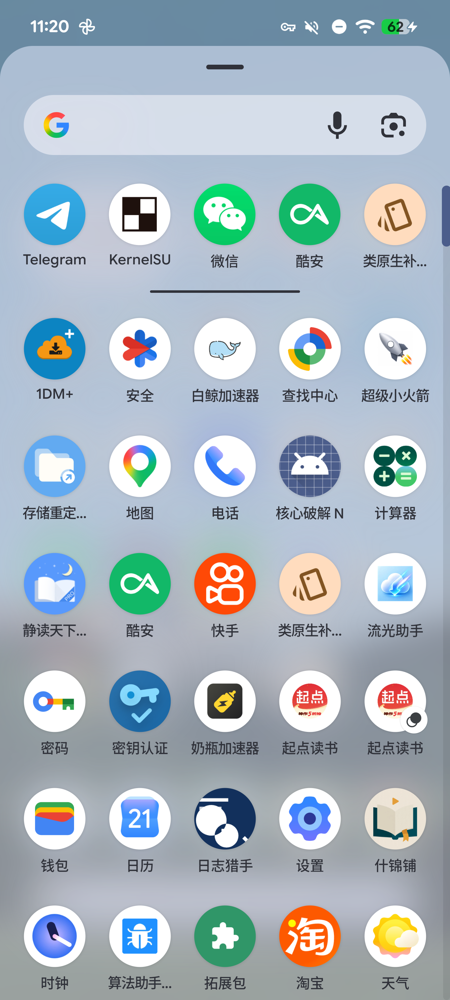

# Pixel 抽屉图标形状 · PLAllAppsShape

LSPosed 模块：让 **Pixel 启动器的抽屉（全部应用）里的图标跟随桌面图标形状设置**。
桌面选的是方圆/水滴/花朵，抽屉里就不会再是一排圆圈。



---

## 为什么能这么做（反编译结论）

用 MT 反编译 `Pixel 启动器_17.apk`（`com.google.android.launcher3`，versionName 1.7 / code 907）确认的形状链路：

| 环节 | 类 / 方法 | 关键点 |
| --- | --- | --- |
| 形状来源 | `graphics.ThemeManager.parseIconState(IconState)` | 按 `PREF_ICON_SHAPE` 在 `ShapesProvider.iconShapes` 里查表，生成 `IconState.iconMask / iconShape / isCircle` |
| 形状实例 | `graphics.ShapeDelegate$GenericPathShape(String)` | 把路径字符串解析成 **100×100 坐标系**的 `basePath` |
| 形状→像素 | `ShapeDelegate$GenericPathShape.addToPath(offX, offY, size, Path)` | `setScale(size/50)` + `postTranslate(offX, offY)` |
| 形状缓存 | `icons.BaseIconFactory.defaultIconShapeCache` | **static** `SparseArray<WeakReference<IconShape>>`，按图标尺寸缓存 |
| 缓存生成 | `BaseIconFactory$$ExternalSyntheticLambda0.invoke()` | `new AdaptiveIconDrawable(new ColorDrawable(BLACK), null).getIconMask()` → `GraphicsUtils.generateIconShape(size, path)` |
| 真正绘制 | `icons.FastBitmapDrawableDelegate`（`FullBleedDrawableDelegate` / `PlaceHolderDrawableDelegate`） | `iconShape.shapeRenderer.render(canvas, paint)`，Path + BitmapShader |

结论：
1. 所有图标位图（`BitmapInfo`）都带一个 `defaultIconShape`，这个 `IconShape` 就是「一张 Path + renderer」，
   **最终由它决定图标轮廓**；
2. 桌面和抽屉**共用** `defaultIconShapeCache`，缓存内容来自系统 `config_icon_mask`（圆形）；
3. `IconState.iconShape` 只影响 `loadPackageIcon()` 要不要用 `roundIconRes`——也就是"圆不圆"，
   并不会把自定义 Path 画到抽屉图标上。

所以抽屉要跟随桌面形状，需要同时做两件事：

```
① 抽屉图标的 BitmapInfo.defaultIconShape ← 桌面形状（ShapeDelegate$GenericPathShape → GraphicsUtils.generateIconShape）
② Resources.getSystem().getString(config_icon_mask) ← 桌面形状的 SVG
   （静态缓存里是 WeakReference，旧 IconShape 被回收后，下次取用就会用新 mask 重建）
```

模块就是这么干的，另外在 `ThemeManager.parseIconState` 之后调一次
`iconShapeData.dispatchValue(...)` 让启动器重绘图标 —— **改完形状直接开抽屉就生效，不用重启启动器**。

## 实现

```
app/src/main/java/com/plallappsshape/
├── launcher/
│   ├── HookEntry.java     Xposed 入口：只注入 Pixel 启动器；读写模块偏好
│   ├── LauncherHooks.java Xposed 胶水：hook BitmapInfo 构造 / ThemeManager.parseIconState /
│   │                      Resources.getString(config_icon_mask)；实现 ShapeSync.Platform
│   ├── ShapeSync.java     框架无关的核心（纯反射 + 接口），可单元测试
│   └── Log.java
└── settings/
    └── SettingsActivity.java  开关界面（LSPosed 会把它加载进启动器进程）
```

**抽屉图标识别**：`BitmapInfo` 不带 `IconOptions`，所以用 owner 判断（实测 owner 就是图标所在的 View）：

* `folder.FolderIcon / Folder / PreviewItemManager / FolderOpenCloseAnimationListener` → 桌面，跳过
* `allapps.AllAppsGridAdapter* / AllAppsRecyclerView / SearchRecyclerView` → 抽屉，替换形状
* `BubbleTextView`（桌面/抽屉共用）→ 也替换，因为桌面图标绝大部分是走缓存逻辑、构造时没有 owner
* 桌面专属 flag（下载进度 16、提取色 64）直接跳过

**桌面形状为圆形时什么都不做**——系统 mask 本来就是圆。

## 安装

1. 安装 APK（GitHub Actions 产物已用 debug key 签名，可直接装）
2. LSPosed 里启用，作用域勾选 **Pixel 启动器**（`com.google.android.apps.nexuslauncher`），重启启动器一次
3. 桌面 → 长按 → 壁纸与样式 → 图标 → **形状**：选方圆/水滴/花朵/自定义绘制都行
4. 打开抽屉即可看到跟随；模块自身设置可从桌面图标进入（启用 / 详细日志）

> ⚠️ **Android 版本**：Pixel 启动器在 Android 15+（SDK 35）跑在「T 进程」，Xposed 无法注入；
> 本模块适用于 **Android 16 及以下**。目标设备（SDK 37 的 ROM）如果启动器也是 T 进程，模块会被
> 正常加载但 hook 不到，日志里会看到 `ThemeManager.parseIconState not found`。

## 与 PixelLauncherEnhanced 共存

两者都改图标形状，LSPosed 允许同时启用，最后生效的 hook 说了算。本模块只看
`iconShape` / `config_icon_mask`，PLE 的 `IconShapes` 还会改 `folderShape` 与 `ShapesProvider`，
**推荐只启用其一**避免互相覆盖。

## 构建

```bash
./gradlew assembleDebug test     # 需要 Android SDK 36 + JDK 17
```

没有 SDK 也能先自查（本仓库自带两个脚本，纯 JDK）：

```bash
JAVAC=$JAVA_HOME/bin/javac ./verify_android.sh   # 用桩类对真实源码做类型检查（84 个类）
JAVA=... JAVAC=... ./verify_tests.sh             # 跑 ShapeSyncTest（12 个用例）
```

CI：`.github/workflows/build.yml`，push / PR / 手动触发，产物在 Actions → Artifacts。

## 排查

```bash
adb logcat -s PLAllAppsShape     # 需在模块设置里打开「详细日志」
```

* `hooks installed` + `BitmapInfo constructors hooked: 2` → 注入成功
* `desktop shape: key=icon_shape_squircle path=M...` → 已取到桌面形状
* `drawer icon shape applied (n)` → 抽屉图标已替换（最多打印 5 次）
* `config_icon_mask overridden` → 系统 mask 已接管

## License

Apache-2.0
